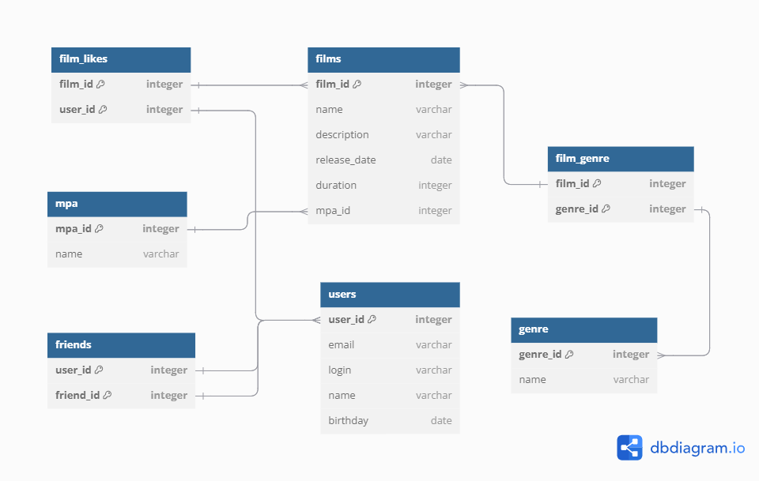

# Java-filmorate
## Film recommendation system
Java, Spring Boot, REST API, H2 Database, JDBC, Maven, Lombok, Slf4j, JDBC Test

Бэкенд для сервиса социальной сети, который работает с фильмами и оценками пользователей

## Функционал приложения
- Регистрация и просмотр пользователей
- Добавление пользователей в список друзей
- Просмотр списка общих друзей
- Добавление и редактирование фильмов
- Система пользовательских оценок(лайков)
- Топ-10 популярных фильмов

## Особенности реализации
- Доступ к методам программы осуществляется через REST API
- Взаимодействие с БД осуществляется с помощью JDBCTemplate
- Структура проекта реализована по типам классов
- Данные полученные из БД обрабатываются с помощью RowMapper
- Реализованы интеграционные тесты для проверки работы приложения с зависимостями(базой данных)

## ER-диаграмма

## Основные сущности
- User
- Film
- Genre
- MPA
- Like

## REST API Endpoints
### Film Controller
| Метод    | Endpoint                          | Описание                           |
|----------|-----------------------------------|------------------------------------|
| `GET`    | `/films`                          | Получение списка всех фильмов      |
| `GET`    | `/films/{id}`                     | Получение фильма по идентификатору |
| `POST`   | `/films`                          | Создание фильма                    |
| `PUT`    | `/films`                          | Редактирование фильма              |
| `PUT`    | `/films/{id}/like/{userId}`       | Добавление лайка фильму            |
| `DELETE` | `/films/{id}/like/{userId}`       | Удаление лайка фильма              |
| `GET`    | `/films/popular`                  | Получение популярных фильмов       |

### User Controller
| Метод    | Endpoint                          | Описание                                 |
|----------|-----------------------------------|------------------------------------------|
| `GET`    | `/users`                          | Получение списка всех пользователей      |
| `GET`    | `/users/{id}`                     | Получение пользователя по идентификатору |
| `POST`   | `/users`                          | Регистрация пользователя                 |
| `PUT`    | `/users`                          | Редактирование профиля пользователя      |
| `PUT`    | `/users//{id}/friends/{friendId}` | Добавление пользователя в друзья         |
| `DELETE` | `/users//{id}/friends/{friendId}` | Удаление пользователя из друзей          |
| `GET`    | `/users/{id}/friends`             | Просмотр друзей пользователя             |
| `GET`    | `/users/{id}/friends/common/{otherId}`             | Просмотр общих друзей                    |

### Genre and Mpa Controller
 Метод    | Endpoint       | Описание                                 |
|----------|----------------|------------------------------------------|
| `GET`    | `/genres`      | Получение списка всех жанров             |
| `GET`    | `/genres/{id}` | Получение жанра по идентификатору        |
| `GET`    | `/mpa`         | Получение списка всех рейтингов          |
| `GET`    | `/mpa/{id}`    | Получение рейтинга по идентификатору| 

